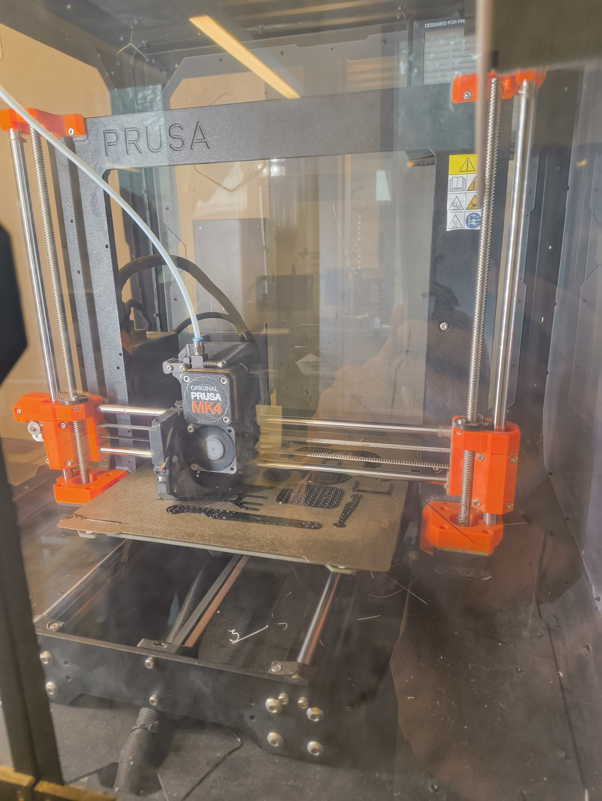

# Compte rendu - Séance 1 (Cédric)
Lors de cette première séance, j'ai personnellement instalé ce qui était nécessaire à la création du github. A savoir, VSCode et Git Bash. Nous avons de plus fais l'inventaire des composants que nous avons reçu et lancé l'impression de certaine pièce pour la conception du robot.
