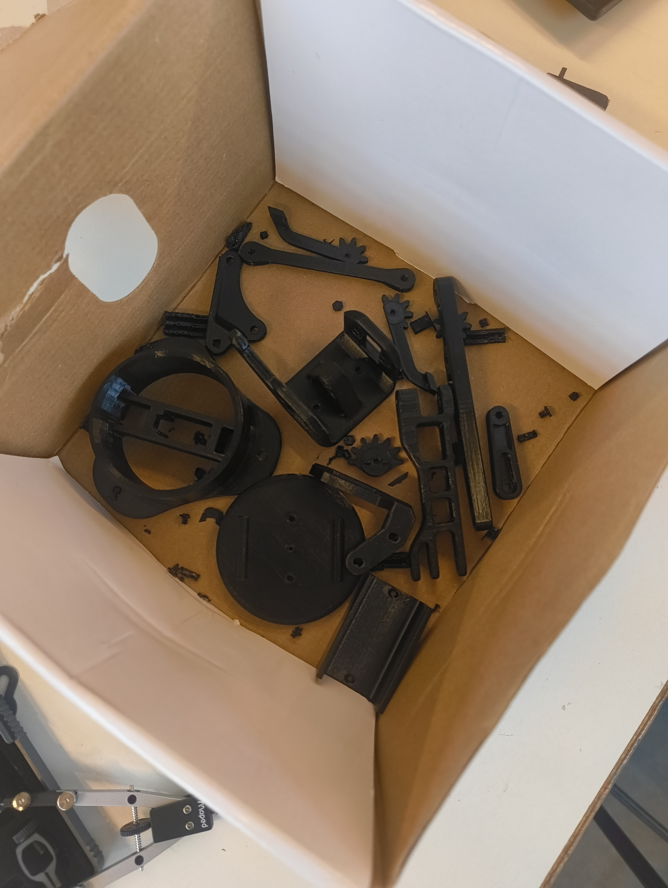
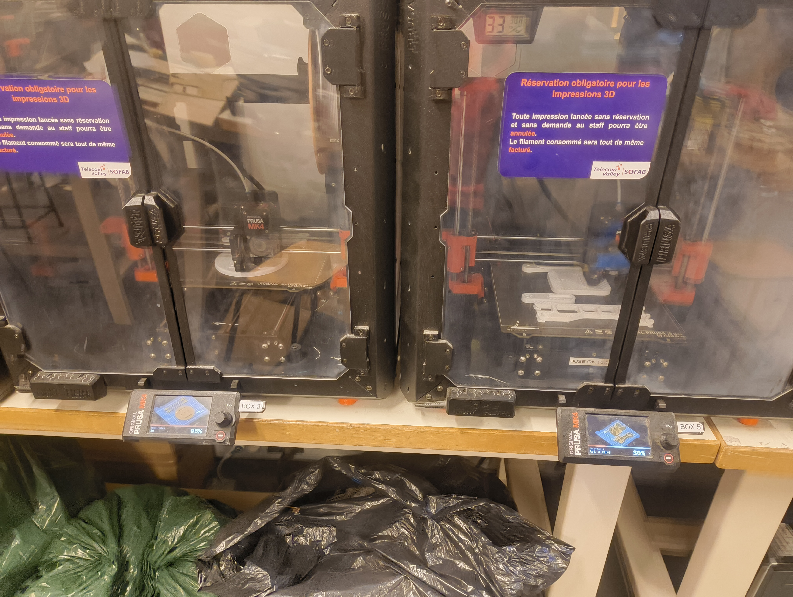
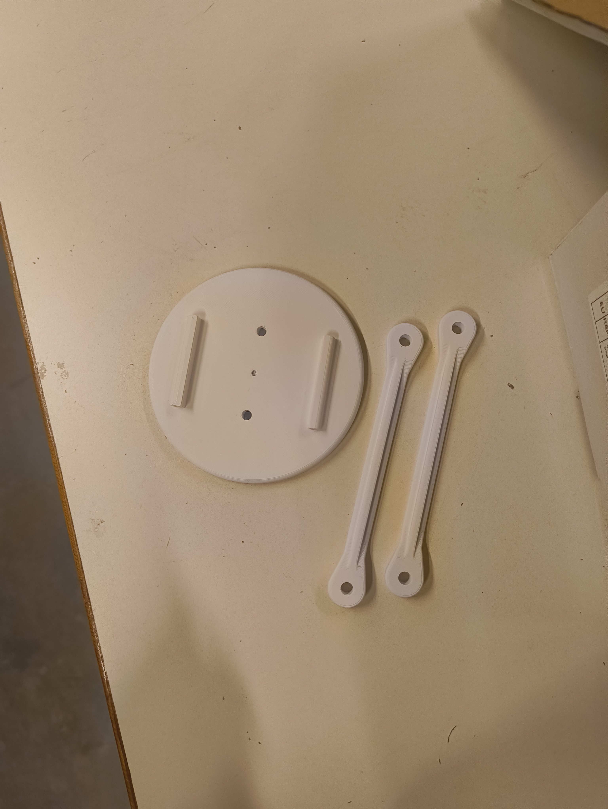

# Compte rendu - Séance 2 (Cédric)
Lors de cette séance, avec Nathan nous avons récupéré nos pièces imprimées de la maquette et avons retiré tous les supports. Nous nous sommes répartis les tâches pour le travail à venir avec de mon coté, commencé à faire la conception des pièces du robot qui vont accueillir la ventouse, le tuyau, la pompe et l'electrovanne.
Nous avons également redimensionner les pièces de la maquette pour les faire à taille réelle en relançant leurs impressions.

