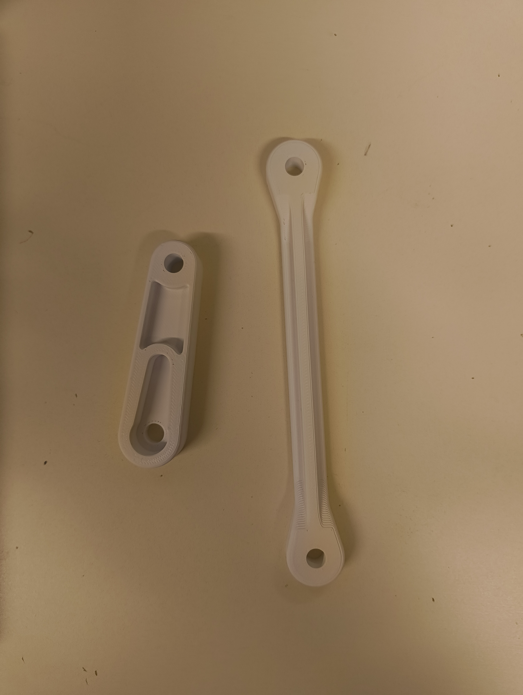
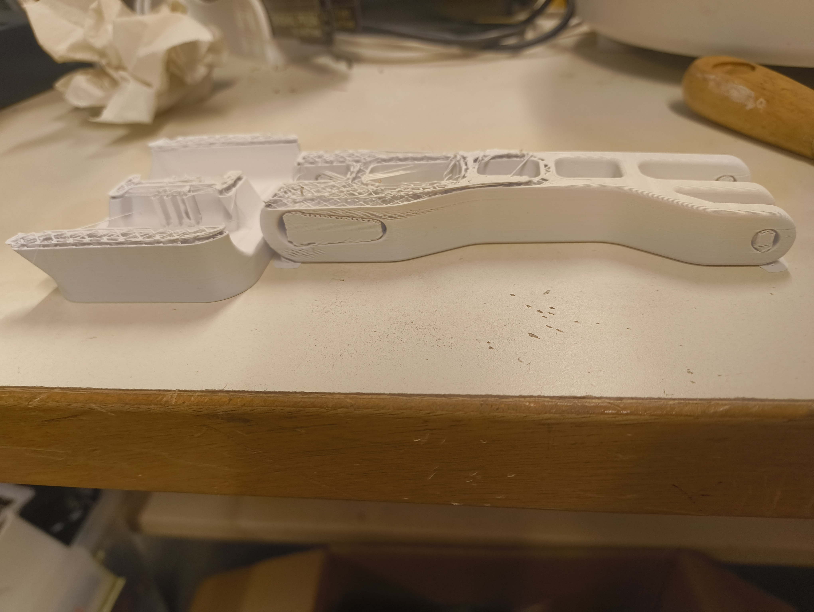
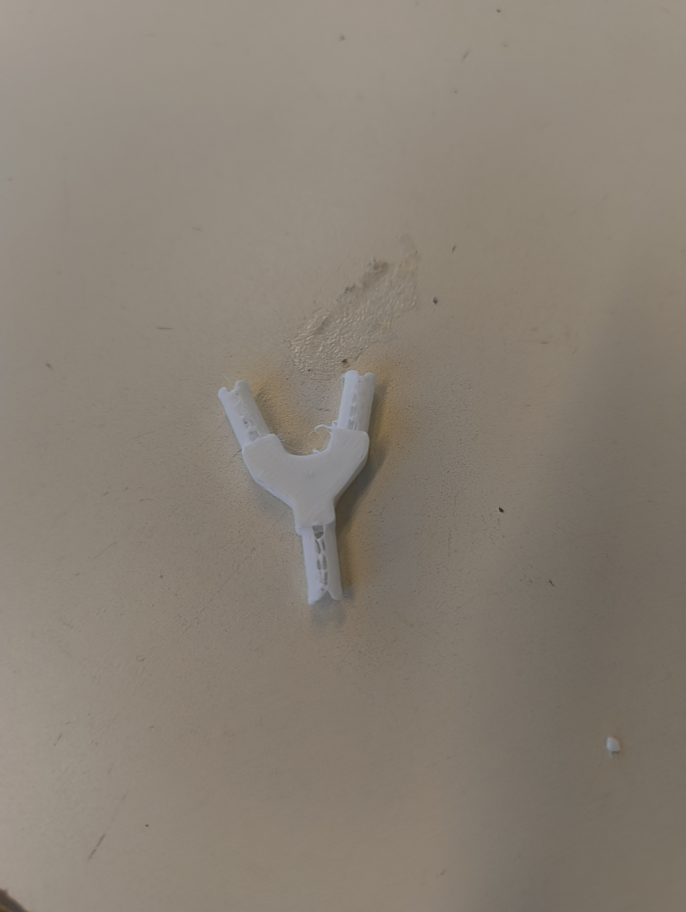
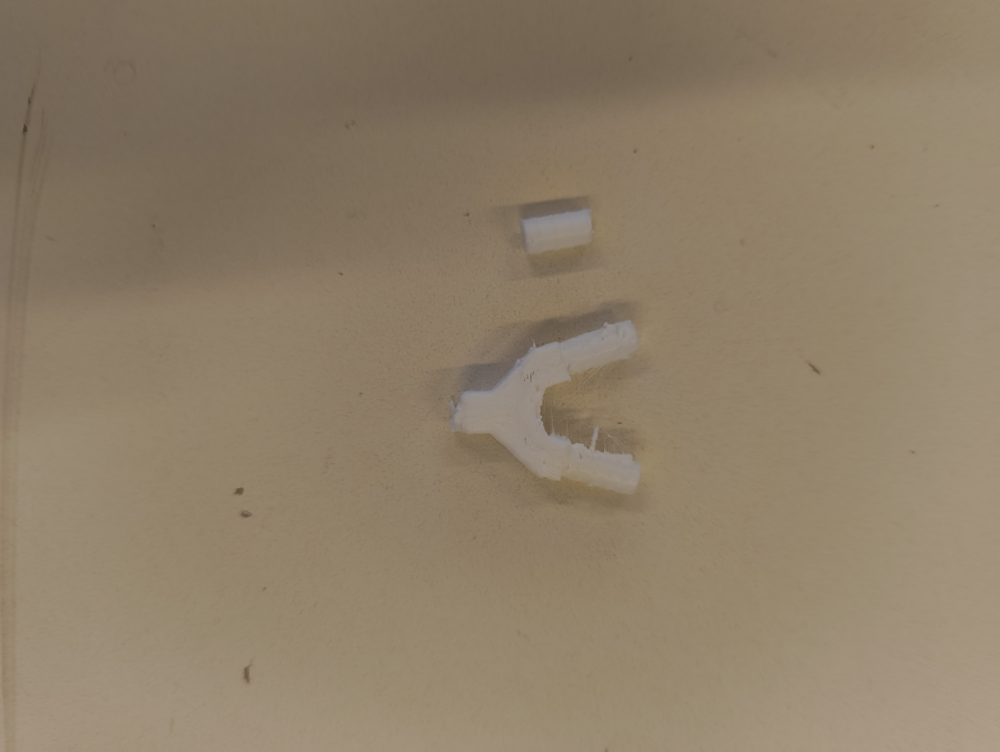

# Compte rendu - Séance 3 (Cédric)
En amont de cette séance, nous avons récupérer les pièces qui étaient en cours d'impression avec certaine n'ayant pas été terminé et donc raté du à un manque de fil.

Lors de cette séance, tandis que mon collègue continuait de s'occuper de la partie électronique pour la pompe et l'électrovanne, je me suis occupé de créer la pièce qui va s'occuper de raccorder les tuyaux qui partent de la pompe, de la ventouse et de l'électrovanne afin de les relier entre eux. Pour cela, à l'aide de fusion, j'ai fait une pièce à trois branche en prenant pour les dimensions des embouts servants à accueillir les parties du tuyau, les mêmes dimensions que celle du raccord pneumatique reliant la vetouse au tuyau. Les embouts sont donc des tuyaux de 4 mm de diamètre interne et 4.5 mm de diamètre externe et de 10 mm de longueur et le corps principal de la pièce est en forme d'un Y et fait 5 mm de hauteur.

Je me suis ensuite lancé dans l'impression de cette pièce à l'imprimantte 3D. Cependant des problèmes d'impression sont arrivés. Tout d'abord, le diamètre externe était de 4.3 mm, mais lors de l'impression, les embouts et le corps de la pièce ne se sont pas correctement imprimées.(cf photo 4) C'est pour cela que j'ai augmenté le diamètre externe à 4.5 mm pour avoir plus d'épaisseur. Puis lors de la seconde impression, les embouts se sont imprimés mais l'impression à laissé quelques imperfections formant ainsi des petits trous dans la pièce.(cf photo 5) Je vais donc d'abord vérifier que les tuyaux s'emboitent bien dans la pièce avant de relancer une impression pour voir quels paramètre je peux changer pour améliorer la qualité de l'impression et en essayant d'utiliser du PETG au lieu du PLA.

