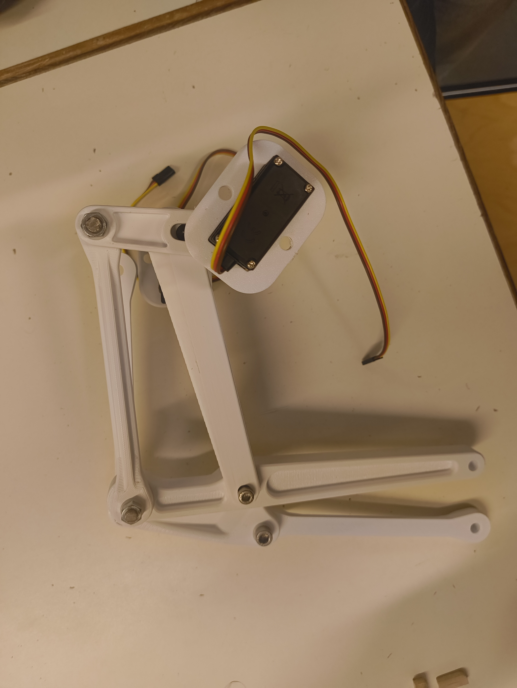
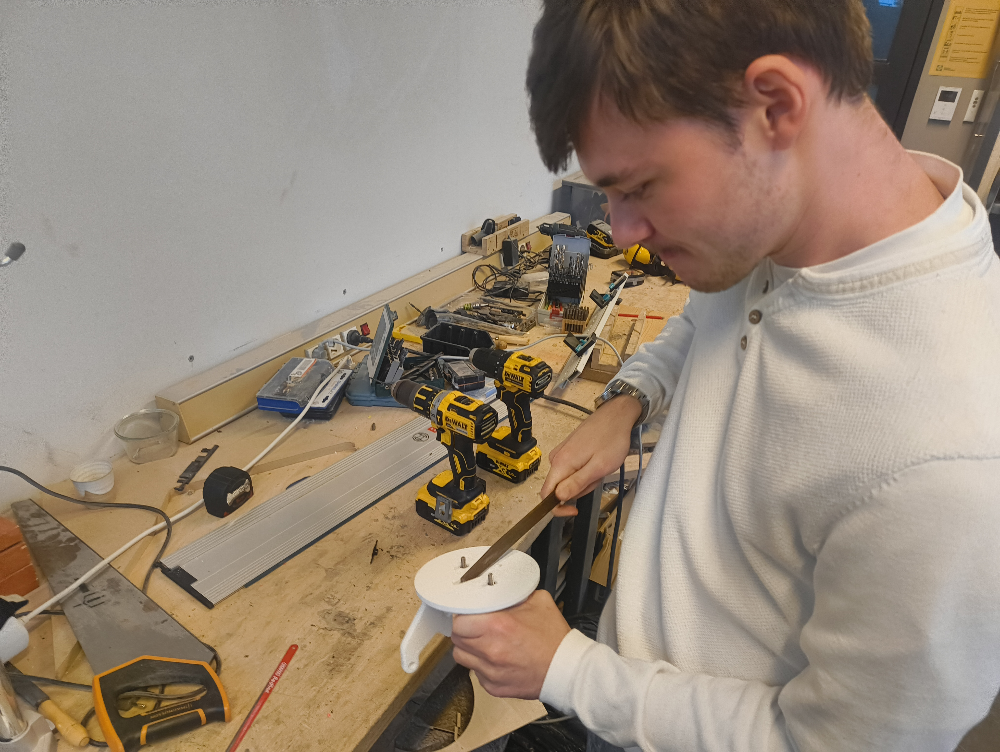

# Compte rendu - Séance 3 (Cédric)
Lors de cette séance, nous avons eu toutes les pièces nécessaire à la construction de la base du robot. Nous avons donc décidé de commencer à la construire en travaillant ensemble. Pour cela nous nous sommes installé au fablab afin d'avoir accès aux outils et à la visserie. Pour assembler notre robot, nous utilisons des vis M4 de 20 à 40 mm en fonction des pièces, cela est accompagné de disque en plastique pour la répartition des forcesainsi que des écrous 5 mm.

Cependant, lors de l'assemblage de certaine pièces, nous avons constaté que certaines pièces n'étaient pas assez grande pour laisser passer certains composants comme le moteur avec la sortie des câbles qui est surélever par exemple. Pour régler ce problème, nous avons donc limé et couper les pièces le nécessitant ou des outils pouvant régler certains problèmes. Cependant, une des pièces du robot à malencontreusement été cassé lors d'un découpage.

Concernant le problème de la séance dernière, le raccord pour le tuyau est exactement à la bonne taille, il va donc falloir que je trouve en amont de la prochaine séance le moyen de renforcer cette pièce pour qu'elle convienne le mieux possible pour le robot.

