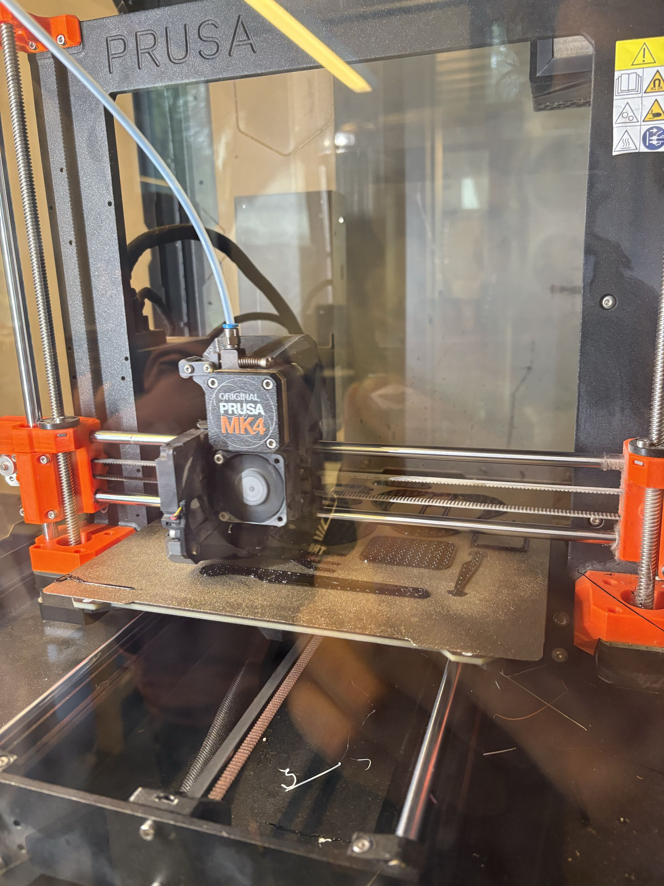

Cette séance a permis de lancer officiellement le projet ArmPick avec la découverte du tapis convoyeur et la création du dépôt 
GitHub. Côté fabrication, le tranchage sous PrusaSlicer a validé de bons paramètres d'impression, confirmés par le succès de la 
fabrication des premières pièces du bras. Enfin, après avoir réceptionné et inventorié les composants, nous avons ajusté 
notre stratégie d'intégration pneumatique et entamé le maquettage électronique sur plaque d'essai.

