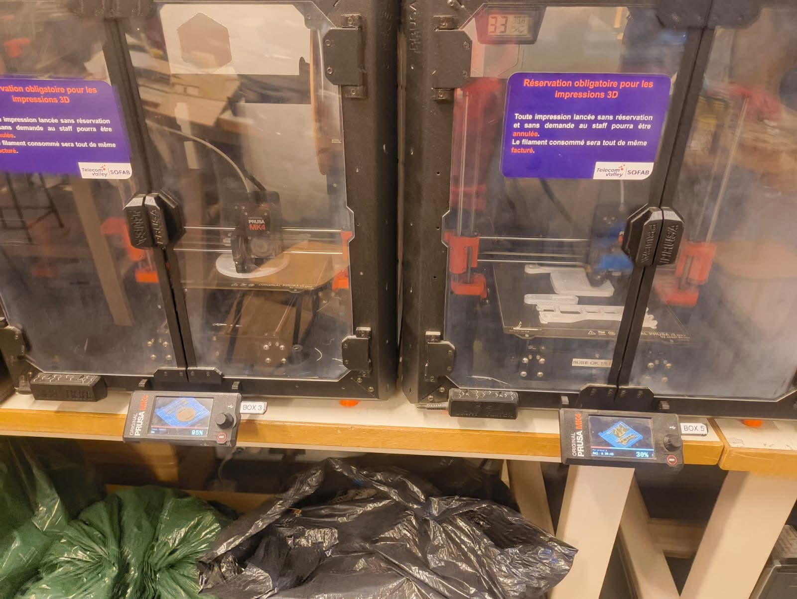
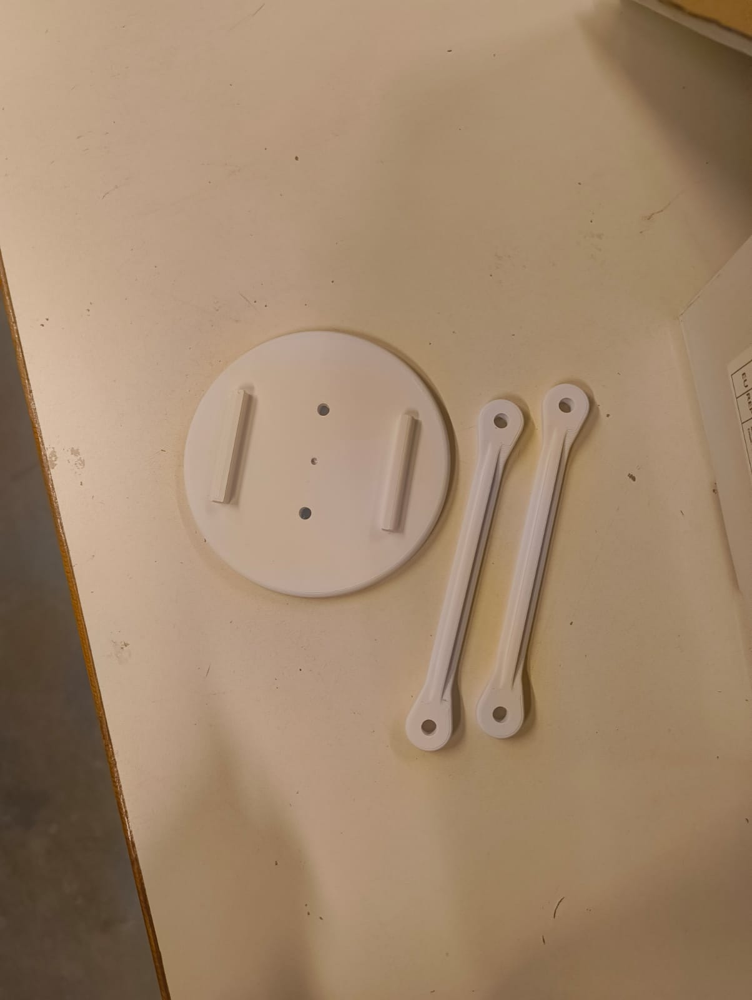
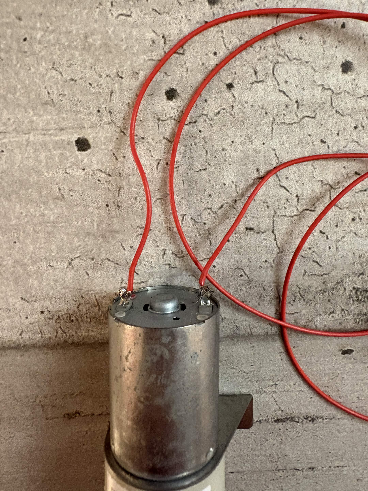

RAPPORT DE SÉANCE N°2 : PROTOTYPAGE & PLATINE PNEUMATIQUE
Auteurs : Nathan Bazon

1. Objectifs de la Séance
Cette deuxième séance a été dédiée à l'ajustement mécanique des pièces du bras robotisé, au redimensionnement sous Prusa Slicer pour optimiser l'intégration, ainsi qu'aux premiers travaux de câblage et d'assemblage électrique.

2. Conception CAO & Impression 3D
Redimensionnement des pièces : Ajustement des dimensions de certaines pièces afin d'élargir les logements et d'intégrer correctement les moteurs qui ne rentraient pas dans les emplacements prévus initialement.
Lancement des impressions : Paramétrage sous PrusaSlicer et impression des composants modifiés. Difficulté à imprimer du fait d'un nombre important de machine en cours d'impression.

4. Avancées Électriques, Apprentissages et Difficultés Rencontrées
Apprentissages techniques : Acquisition des compétences de base pour le dénudage des câbles électriques et la réalisation de soudures propres pour raccorder les composants (pompe et électrovanne).

Développement du circuit pneumatique : Recherche d'un nouvel adaptateur qui corresponde au voltage de la pompe et de l'électrovanne, branchements entre les différents composants.
Problématique de outillage : Difficulté rencontrée lors du montage du bornier à vis du module de puissance, faute de disposer d'un tournevis de précision aux dimensions adéquates dans l'immédiat (résolu temporairement grâce au prêt du matériel d'Eliot).

Objectifs de la prochaine séance : Récupération des pièces imprimées, finalisation du câblage de puissance 12V, création du raccord en Y entre les tuyaux et impressions de la pièce, montage du bras + assemblage mécanique définitif du système de préhension si le temps nous le permet.
